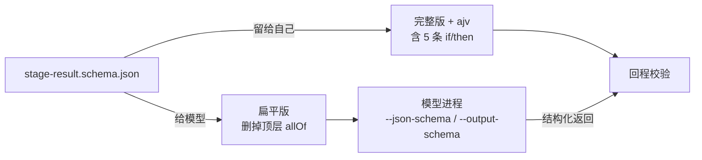

# 契约

本仓库与编排器之间的全部耦合就是两个文件：

| 文件 | 给谁读 | 内容 |
|---|---|---|
| [`skills/_shared/handoff-spec.md`](../skills/_shared/handoff-spec.md) | 每个 skill（开工前必读）、维护者 | 工件目录、交接文档形状、四态语义、问题结构、写作纪律、自查清单、结构化返回字段语义、人工反馈通道 |
| [`schemas/stage-result.schema.json`](../schemas/stage-result.schema.json) | 模型（`--json-schema`）、编排器（回程校验） | 结构化返回的机器可读定义 |

两者版本一致（当前 0.12.0），变更史在 handoff-spec 顶部。

## schema 的两个形态

同一份 schema 出去两次：

- **给模型的是扁平版**：模型侧的结构化输出接口不支持顶层 `allOf`，不剥直接被拒。
- **回程用完整版**：五条条件约束（完成态的 review/acceptance 必填 `verdict`；review 必填 `axes`；`NEEDS_CONTEXT` 必带 ≥1 个问题；`BLOCKED` 必带 `blocked_reason`；`DONE_WITH_CONCERNS` 必带 ≥1 条 `concerns`）在这里生效。少一条即阶段未完成。

放宽的是接口能接受的形式，没放宽的是标准。剥 `allOf` 的一行在编排器 `src/schema.ts`。

## Codex 下的额外转换

OpenAI 严格结构化输出要求每个对象的 `required` 覆盖全部属性、不认 `default`。编排器的 codex 引擎把扁平版再转一次：可选字段变可空（`type: [x, "null"]`），全属性进 `required`；返回值里**原本可选**的 null 剥回缺省，**原本必填可空**的（如 `axes.spec.worst`）保留。skill 本身不用为此改动。

## 改契约的流程

1. 改 `schemas/stage-result.schema.json`。
2. 改 `handoff-spec.md`：§7 字段表 + 顶部版本号与变更史一句话。
3. 受影响的 skill 同步（如新字段要哪个阶段填）。
4. `plugin.json` 次版本 +1。
5. 编排器仓库 `src/types.ts` 的 `StageResult` 跟随，两个仓库同时出 PR。
6. 跑评估集。

## 字段速查

| 字段 | 必填 | 说明 |
|---|---|---|
| `stage` | ✓ | `clarify / plan / implement / review / acceptance / compound` |
| `status` | ✓ | 四态 |
| `handoff_path` | ✓ | `docs/pipeline/<ticket>/<file>.md`，**文件为准** |
| `summary_for_card` | ✓ | ≤500 字，面向业务方 |
| `open_questions[]` | NEEDS_CONTEXT 时 | `{id, question, options[≥2], recommended, why}` |
| `concerns[]` | DONE_WITH_CONCERNS 时 | 每条一句话 |
| `blocked_reason` | BLOCKED 时 | 障碍与已尝试的解法 |
| `verdict` | review/acceptance 完成态 | `PASS / PASS_WITH_SUGGESTIONS / BLOCK`，与 status 正交 |
| `axes` | review 完成态 | `{spec:{total,failed,worst}, quality:{critical,important,minor,worst}}`，两轴永不合并 |
| `stale_hints[]` | 可选 | 核实到与现状矛盾的 `05-knowledge-hints.md` 条目标题（逐字） |
